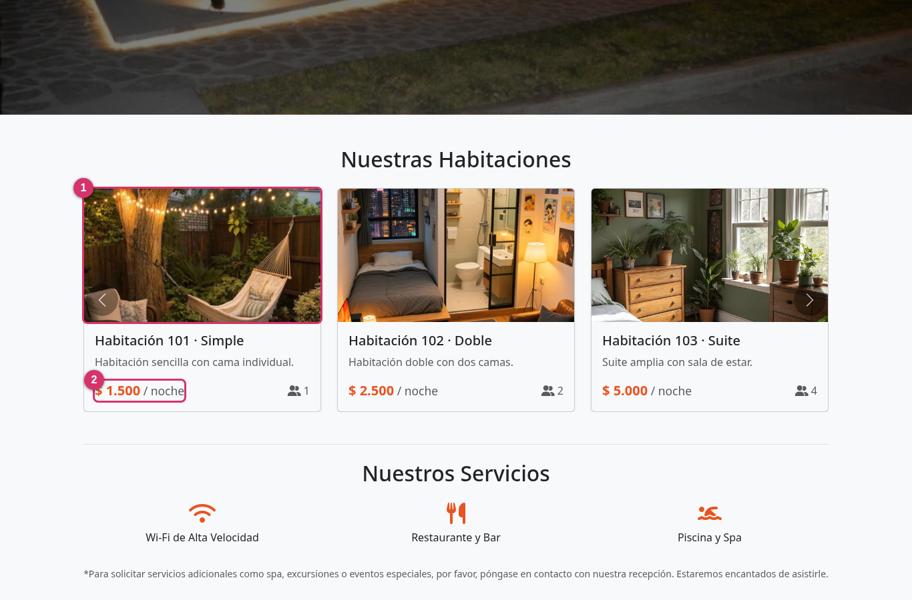
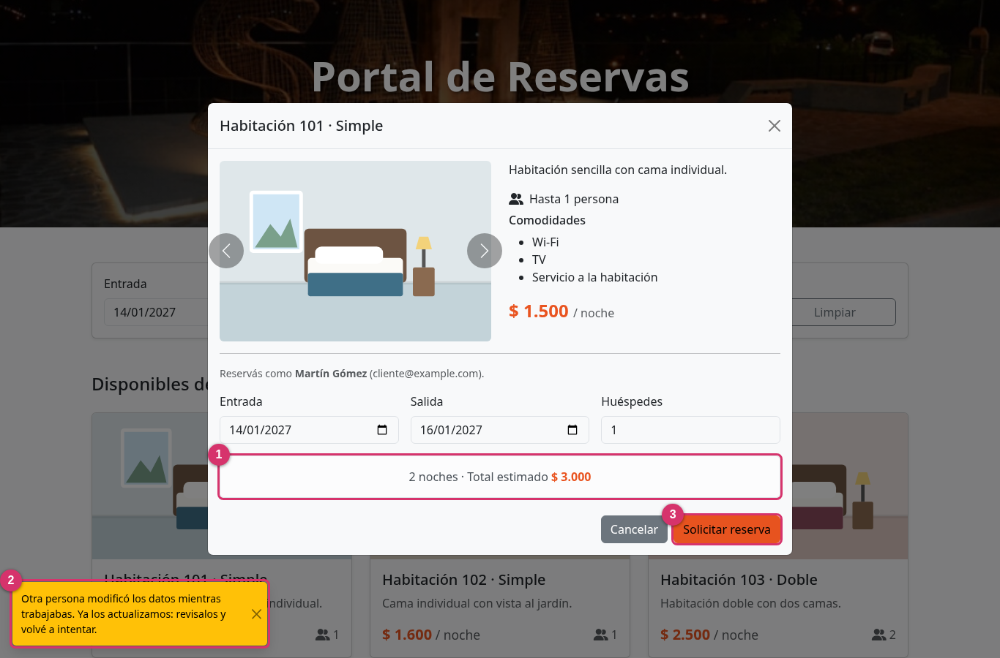
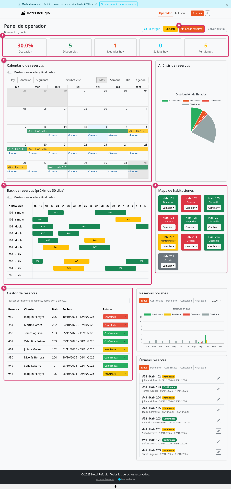
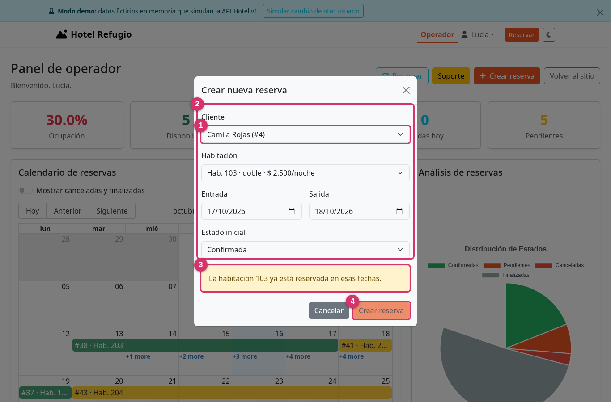
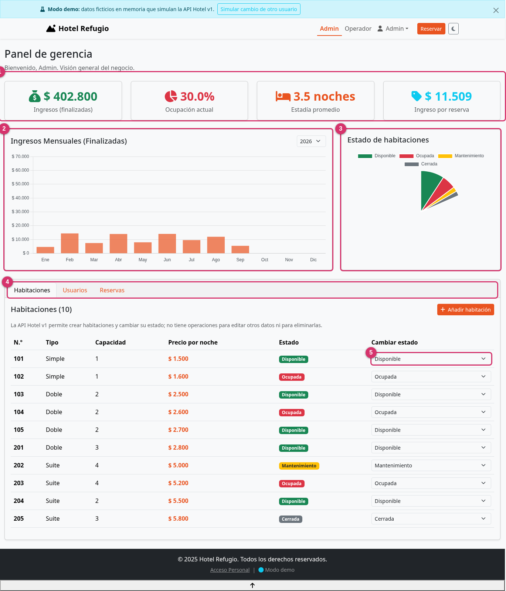
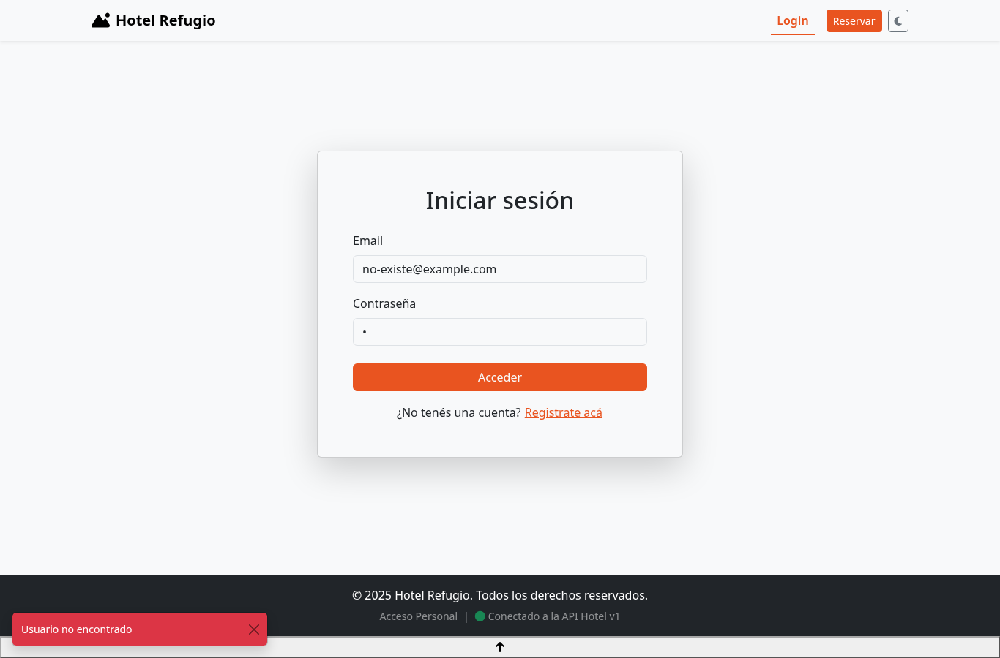
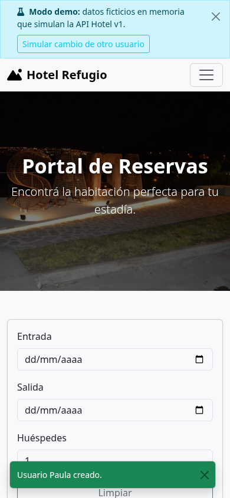
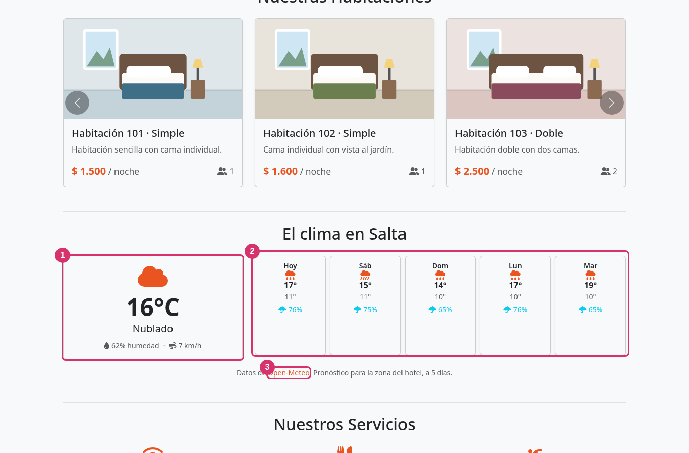

# Integración de la API Hotel v1 en Hotel Refugio

**Informe de proyecto según las buenas prácticas del PMBOK®**

| Dato | Detalle |
|---|---|
| **Proyecto** | Hotel Refugio — integración de la API Hotel v1, conservación de la demo y mejora de interfaces |
| **Asignatura** | Lenguajes IV (continuación del Trabajo Práctico Integrador) |
| **Autor** | Antonio Yurquina |
| **Fecha** | 16 de octubre de 2026 |
| **Repositorio** | `Hotel-Refugio`, rama `integracion-api-v1` |
| **Documentos relacionados** | `INFORME_TECNICO.md` (descripción del sistema original), `README.md` (uso) |

---

## Resumen ejecutivo

Hotel Refugio es una aplicación web (React + Vite) para gestionar un hotel, con tres frentes: sitio público con reservas, panel de operador y panel de gerencia. Hasta ahora funcionaba contra un servidor que ya no está en línea, por lo que la aplicación se publicó con una **API simulada** («demo») y varias operaciones que en realidad eran falsas: el registro de usuarios no se guardaba, las reservas de los clientes solo enviaban un correo, y la edición y el borrado de usuarios y habitaciones ocurrían únicamente en la memoria del navegador.

Se entregó la **API Hotel v1** con su documentación. Este proyecto la integra completa, **conserva la demo** dentro del repositorio —ahora con exactamente el mismo contrato que la API real— y mejora las interfaces.

**Resultados:**

- Las 11 rutas del índice de la API están implementadas en un cliente propio, con control de concurrencia por versión y manejo del error `409`.
- La demo y la API real son intercambiables con una sola variable de entorno (`VITE_API_URL`).
- La interfaz se adapta a lo que la API permite en lugar de simular lo que no existe.
- Se incorporó una integración externa nueva, el **pronóstico del clima de Salta** (Open-Meteo), y se documentaron todas las integraciones de terceros (sección 3.5).
- Se detectaron y corrigieron **12 desvíos** entre el código previo y el contrato de la API (sección 4.1).
- Verificación: **53 pruebas unitarias**, **4 pruebas de contrato contra la API real** (más 1 de escritura opcional), **22 verificaciones de navegador en modo demo** y **10 contra la API real**. Lint sin advertencias y compilación correcta.

**Qué debe saber quien evalúe:** la API v1 tiene limitaciones propias —sin autenticación por token, contraseñas sin cifrar, sin validación de solapamientos— que se documentan en la sección 5.3 y se mitigaron en el frontend solo hasta donde es posible.

---

## 1. Grupo de procesos de Inicio

### 1.1 Acta de constitución

| Elemento | Contenido |
|---|---|
| **Propósito** | Que Hotel Refugio use una API real y documentada en lugar de simulaciones, sin perder la demo pública. |
| **Justificación** | El servidor original dejó de existir. La demo permitía mostrar el proyecto, pero ocultaba funciones que no persistían, y la nueva API necesita un frontend que respete su contrato. |
| **Objetivos medibles** | (1) Implementar el 100 % de las rutas de la documentación (11). (2) Que demo y API real compartan contrato, comprobado con pruebas. (3) Cero operaciones simuladas presentadas como reales. (4) Lint sin advertencias y pruebas automáticas pasando. (5) Entregar un informe presentable. |
| **Alcance de alto nivel** | Cliente de la API, adaptación de la demo, refactor del estado de la aplicación, mejora de interfaces, pruebas, documentación e informe. |
| **Fuera de alcance** | Cambios en el servidor de la API; autenticación por token (la API no la ofrece); migración de datos; publicación en producción. |
| **Supuestos** | La documentación PDF de la API es la fuente de verdad. La API responde desde internet con CORS abierto (verificado). |
| **Restricciones** | Una sola persona desarrolladora; herramientas gratuitas; la API v1 no se puede modificar desde este proyecto; la fecha de presentación es próxima. |
| **Criterio de éxito** | Una persona puede recorrer los tres roles tanto en demo como contra la API real sin errores, y el informe permite explicar las decisiones. |

### 1.2 Registro de interesados

| Interesado | Interés | Influencia | Estrategia |
|---|---|---|---|
| **Profesora** (evaluación) | Que el trabajo cumpla los requisitos y se pueda defender | Alta | Informe claro, demo en vivo con el aviso de conflicto 409, trazabilidad ruta ↔ implementación |
| **Antonio Yurquina** (patrocinador y desarrollador) | Entregar a tiempo y poder explicar cada decisión | Alta | Decisiones documentadas en el informe; código que se lee de corrido |
| **Equipo de la API** | Que el frontend use bien el contrato | Media | Pruebas de contrato que detectan desvíos |
| **Clientes del hotel** (usuarios finales) | Reservar sin errores | Media | Validaciones previas, mensajes claros |
| **Operadores y gerencia** (usuarios finales) | Gestionar el día a día | Media | Paneles con nombres en lugar de números, filtros y confirmaciones |

---

## 2. Grupo de procesos de Planificación

### 2.1 Gestión del alcance

**Enunciado del alcance.** Implementar la API Hotel v1 en el repositorio Hotel-Refugio, dejar la demo funcionando con el mismo contrato, mejorar las interfaces y elaborar un informe.

**Estructura de desglose del trabajo (EDT).**

```
1. Hotel Refugio con API Hotel v1
├── 1.1 Diagnóstico
│   ├── 1.1.1 Lectura de la documentación de la API
│   ├── 1.1.2 Prueba de lectura contra la API real
│   └── 1.1.3 Auditoría del código existente
├── 1.2 Capa de datos
│   ├── 1.2.1 Cliente de la API (ErrorApi, un método por ruta)
│   ├── 1.2.2 Utilidades: fechas, formato, reglas de reservas, estadísticas
│   └── 1.2.3 Hook de estado con versiones y manejo de 409
├── 1.3 Demo
│   ├── 1.3.1 Servidor simulado con el contrato de la API
│   └── 1.3.2 Datos ficticios coherentes (pesos, tipos, fechas ISO)
├── 1.4 Interfaces
│   ├── 1.4.1 Componentes compartidos (modal, confirmación, insignias, pantallas)
│   ├── 1.4.2 Sitio público y portal de reservas
│   ├── 1.4.3 Panel de operador
│   ├── 1.4.4 Panel de gerencia
│   └── 1.4.5 Integraciones externas (clima)
├── 1.5 Calidad
│   ├── 1.5.1 Lint y pruebas unitarias
│   ├── 1.5.2 Pruebas de contrato contra la API real
│   └── 1.5.3 Pruebas de navegador (demo y API real)
└── 1.6 Cierre
    ├── 1.6.1 README y variables de entorno
    └── 1.6.2 Informe PMBOK
```

**Requisitos y trazabilidad.**

| Id | Requisito | Verificación |
|---|---|---|
| R1 | Implementar las 11 rutas documentadas | Tabla 3.2; pruebas de cliente |
| R2 | Enviar `version` como número y manejar `409` volviendo a leer y avisando | `cliente.test.js`, `demo.test.js`, prueba de navegador del conflicto |
| R3 | Enviar fechas `YYYY-MM-DD` y mostrar en hora argentina | `fechas.test.js`, ciclo real de PUT |
| R4 | `PUT /reservas/:id` con todos los campos | Ciclo real: crear, modificar, eliminar |
| R5 | Validar en el frontend lo que la API no valida (fechas y solapamientos) | `reservas.test.js`, prueba de navegador |
| R6 | No usar `GET /usuarios` contra la API real (ruta de test que expone contraseñas) | `CAPACIDADES.directorioUsuarios` |
| R7 | Respuestas de `/registrar` y `/usuarios` con formato distinto al resto | `cliente.test.js` |
| R8 | Imagen por defecto para habitaciones sin foto | Prueba de navegador con la API real |
| R9 | Conservar la demo con el mismo contrato | `demo.test.js` |
| R10 | Interfaces accesibles y adaptables a móviles | Prueba de navegador (390 px sin desbordamiento) |

### 2.2 Gestión del cronograma

El trabajo se ejecutó en una jornada (16/10/2026) con hitos secuenciales; cada uno se cerró con una verificación antes de pasar al siguiente (compuerta de calidad).

| Hito | Contenido | Compuerta |
|---|---|---|
| H1 Diagnóstico | EDT 1.1 | Lista de desvíos validada contra la API real |
| H2 Capa de datos | EDT 1.2 y 1.3 | 42 pruebas unitarias en verde |
| H3 Interfaces | EDT 1.4 | Lint limpio y compilación correcta |
| H4 Verificación | EDT 1.5 | 22 + 10 verificaciones de navegador |
| H5 Cierre | EDT 1.6 | Informe y README entregados |

Ruta crítica: la **capa de datos** bloquea todas las interfaces, por eso se construyó y probó primero.

### 2.3 Gestión de costos y recursos

- **Costo monetario:** cero. Todo el software es de código abierto (React, Vite, Bootstrap, Vitest, ESLint) y la API es provista.
- **Recursos:** una persona desarrolladora y un asistente de IA que escribió y ejecutó código y pruebas bajo su dirección. Toda la revisión y las decisiones quedan a cargo de la persona responsable del trabajo.
- **Entorno:** Debian, Node 20, Chrome para las pruebas de navegador.

### 2.4 Gestión de la calidad

| Medida | Meta | Resultado |
|---|---|---|
| Advertencias de lint | 0 | **0** |
| Pruebas unitarias | Todas en verde | **53 / 53** |
| Pruebas de contrato (API real) | Todas en verde | **5 / 5** (4 de lectura y 409 + 1 de escritura) |
| Verificaciones de navegador, demo | 100 % | **22 / 22** |
| Verificaciones de navegador, API real | 100 % | **10 / 10** |
| Errores en consola del navegador | 0 | **0** |
| Desbordamiento horizontal en móvil | Ninguno | **Ninguno** |

**Prácticas aplicadas:** pruebas escritas junto con el código, la demo probada contra el mismo contrato que la API real, validación defensiva del formato (por ejemplo, el cliente se niega a enviar una `version` que no sea numérica, porque con un texto la API respondería siempre `409`), y eliminación de código sin uso para reducir la superficie de errores.

### 2.5 Gestión de riesgos

Escala: probabilidad (P) e impacto (I) de 1 a 3; exposición = P × I.

| Id | Riesgo | P | I | Exp. | Respuesta | Estado |
|---|---|:-:|:-:|:-:|---|---|
| RK1 | Conflictos de concurrencia (dos personas editan a la vez) | 3 | 2 | 6 | **Mitigar**: versión numérica en cada escritura, relectura y aviso ante 409 | Mitigado, probado |
| RK2 | La API no valida solapamientos: se podrían crear reservas dobles | 3 | 3 | 9 | **Mitigar**: validación previa en el cliente; **aceptar** el resto (dos personas que reserven a la vez) | Parcialmente mitigado |
| RK3 | Desfase de un día por zona horaria | 2 | 3 | 6 | **Evitar**: todas las fechas se normalizan a hora argentina; probado con zonas distintas | Mitigado, probado |
| RK4 | La API cambia o cae durante la presentación | 2 | 3 | 6 | **Mitigar**: la demo funciona sin servidor con el mismo contrato; pantalla de error con reintento | Mitigado |
| RK5 | Las contraseñas se guardan sin cifrar | 3 | 3 | 9 | **Transferir** al equipo de la API; **mitigar** avisando en el formulario de registro | Abierto (fuera de alcance) |
| RK6 | Sin tokens: cualquier llamada directa a la API es válida | 3 | 3 | 9 | **Transferir** al equipo de la API; el frontend solo oculta pantallas por rol | Abierto (fuera de alcance) |
| RK7 | `POST /registrar` exige `tipo_usuario` y, según la documentación, acepta los tres roles sin autenticación | 2 | 3 | 6 | Los formularios públicos siempre envían `cliente`; **recomendación** al equipo de la API: aceptar solo `cliente` en el alta pública. No se probó en la API real para no crear usuarios | Abierto, a verificar |
| RK8 | Probar escrituras contra una API compartida | 2 | 2 | 4 | **Evitar** salvo un único ciclo crear → modificar → eliminar en una fecha lejana (2031); el resto, respuestas 409 que no modifican datos | Controlado (ver 4.2) |
| RK9 | Foto faltante para habitaciones nuevas (la API tiene 10 juegos de fotos) | 2 | 1 | 2 | **Mitigar**: imagen por defecto | Mitigado |
| RK10 | Un servicio de terceros (clima, mapas, correo) deja de responder o cambia | 2 | 1 | 2 | **Mitigar**: ninguno es imprescindible para reservar; la sección del clima se oculta si falla y se guarda 30 minutos en el navegador para no repetir consultas. Probado con el servicio bloqueado | Mitigado |
| RK11 | Claves públicas de EmailJS visibles en el código del navegador | 2 | 2 | 4 | **Aceptar** (EmailJS está pensado así) y **recomendar** restringir la cuenta a los dominios del sitio y limitar los envíos | Abierto, recomendación |

### 2.6 Gestión de las comunicaciones y de los interesados

- **Hacia la profesora:** este informe, la demo en línea y el aviso «Simular cambio de otro usuario» para mostrar el conflicto en vivo.
- **Hacia el equipo de la API:** las pruebas de contrato (`npm test` con `VITE_API_URL`) sirven como lenguaje común; los riesgos RK5–RK7 son recomendaciones concretas.
- **Dentro del repositorio:** `README.md` con modos de uso y mensajes de commit que explican el porqué de cada cambio.

### 2.7 Gestión de las adquisiciones y dependencias

| Dependencia | Tipo | Gestión |
|---|---|---|
| API Hotel v1 | Servicio externo | Documentación como contrato; pruebas de contrato; modo demo como alternativa |
| Bibliotecas de código abierto | Software | Versiones fijadas por `package-lock.json` |
| EmailJS | Servicio externo | Se mantiene solo para contacto y soporte; ya no interviene en las reservas |

**Decisión sobre la URL de la API.** El repositorio es público (GitHub Pages) y en una limpieza anterior se había retirado el dominio del backend. Se mantuvo ese criterio: la URL no figura en el código ni en la documentación; se configura con `VITE_API_URL` en un archivo `.env.local` que no se versiona (`.env.example` muestra el formato).

### 2.8 Gestión de cambios

Todo desvío del contrato se registró primero como hallazgo (sección 4.1) y se resolvió con un cambio trazable a un requisito. Los cambios se agruparon en un commit descriptivo sobre una rama aparte (`integracion-api-v1`), para revisar y fusionar a `main` cuando corresponda.

---

## 3. Grupo de procesos de Ejecución

### 3.1 Arquitectura

```
┌────────────────────────── Navegador ──────────────────────────┐
│  Páginas (sitio, operador, gerencia)                          │
│        │ usan                                                 │
│  useHotel  ── estado, versiones de tabla, validaciones        │
│        │ llama                                                │
│  api/cliente.js ── un método por ruta, ErrorApi               │
│        │ fetch                                                │
│        ├── modo API real ──────────►  API Hotel v1 (HTTPS)     │
│        └── modo demo ──► demo/api.js (servidor en memoria)    │
└───────────────────────────────────────────────────────────────┘
```

**Decisiones de diseño y su justificación**

| Decisión | Justificación |
|---|---|
| **Cliente de la API aislado** (`src/api/cliente.js`) | Un único lugar conoce las rutas, el formato de errores y la regla de la versión numérica. Las pantallas no manejan HTTP. |
| **Escrituras pesimistas** (se espera la respuesta antes de actualizar la pantalla) | El código anterior actualizaba primero y revertía si fallaba, lo cual es frágil con versiones de tabla. Esperar es más simple y siempre muestra el estado real. |
| **La versión se guarda en una referencia** (`useRef`) | Evita enviar una versión vieja desde un cierre de función desactualizado, que causaría `409` espurios. |
| **Demo con el contrato real** (misma forma de respuesta, `409`, enums, fechas ISO) | Lo que se prueba en la demo es lo que ocurrirá con la API. Un único cliente sirve a ambos. |
| **`CAPACIDADES` en `config.js`** | La interfaz oculta lo que la API v1 no ofrece, en vez de simularlo. Si la API crece, se activan con una línea. |
| **Fechas en hora argentina** (`Intl` con zona fija) | La API entrega medianoche argentina como `03:00Z`; sin normalizar, un navegador en otra zona mostraría un día corrido. |
| **Validar solapamientos antes de enviar** | La API no lo hace (documentado). Intervalos semiabiertos: se puede entrar el día que otra reserva sale. |
| **`ocupada` no bloquea reservar** | Es un estado de hoy; la disponibilidad futura se decide por fechas. Solo `mantenimiento` y `cerrada` impiden reservar. |

### 3.2 Mapa de la API v1 y su implementación

**Tabla 3.2.** Las 11 rutas del índice de la documentación.

| Método y ruta | Método del cliente | Uso en la interfaz |
|---|---|---|
| `GET /habitaciones` | `listarHabitaciones` | Carga inicial; relectura tras un 409 |
| `POST /habitaciones` | `crearHabitacion` | Gerencia → Añadir habitación (sin versión, número único validado antes) |
| `PUT /habitaciones/:id` | `cambiarEstadoHabitacion` | Mapa de habitaciones (operador), selector de estado (gerencia) |
| `GET /reservas` | `listarReservas` | Carga inicial; recarga manual |
| `POST /reservas` | `crearReserva` | Solicitud del cliente (queda `pendiente`); alta del operador |
| `PUT /reservas/:id` | `modificarReserva` | Edición del operador; cambio de estado (envía todos los campos) |
| `DELETE /reservas/:id` | `eliminarReserva` | Detalle de reserva (operador), tabla de gerencia, con confirmación; la versión viaja en el cuerpo |
| `POST /login` | `iniciarSesion` | Acceso; se usa `datos.tipo_usuario` para decidir las pantallas |
| `POST /registrar` | `registrar` | Registro público (siempre `cliente`) y alta de personal desde gerencia |
| `GET /usuarios` | `listarUsuarios` | **Solo en modo demo**: ruta de test que expone contraseñas |
| `GET /patas/<archivo>` | `imagenHabitacion` | Fotos por convención `id_habitacion` + `a`/`b`/`c`, con imagen por defecto |

### 3.3 Mejoras de interfaz

| Área | Antes | Ahora |
|---|---|---|
| **Avisos** | `alert()` bloqueantes | Avisos no bloqueantes (máximo 3, abajo a la izquierda) con rol accesible; los errores y conflictos duran más |
| **Ventanas** | HTML repetido en cada pantalla | Componente `Modal` único: cierra con Escape, devuelve el foco, bloquea el scroll del fondo |
| **Eliminar** | `window.confirm` | Diálogo de confirmación con indicador de progreso |
| **Precios y fechas** | `$1500.00` y `toLocaleDateString()` según el navegador | `$ 1.500` y `20/10/2026` en hora argentina |
| **Tablas** | Números de usuario y habitación | Nombre del cliente y número de habitación; filtros y búsqueda; encabezados fijos |
| **Reservar** | Solo mandaba un correo | Crea la reserva `pendiente` en la API, muestra noches y total, avisa si las fechas chocan y confirma con el número de reserva |
| **Formularios** | Etiquetas sin vincular, sin validación inline | Etiquetas asociadas, `autocomplete`, límites de longitud de la API, errores bajo cada campo |
| **Estados vacíos y errores** | El indicador de carga nunca aparecía; los fallos de red eran silenciosos | Pantalla de carga y pantalla de error con «Reintentar» |
| **Fotos** | Rotas si faltaban | Imagen por defecto |
| **Rack de 30 días** | Barras sin recorte para reservas que empiezan antes o terminan después de la ventana | Barras recortadas a la ventana de 31 días |
| **Marca** | Algunos componentes usaban el azul de Bootstrap en lugar del naranja de la marca | Color primario unificado en toda la interfaz |
| **Modo demo** | Sin señal visual | Aviso con botón «Simular cambio de otro usuario»; en el pie se indica el modo |

### 3.4 Qué hace cada rol

- **Cliente:** busca por fechas y huéspedes, ve el total, solicita la reserva y sigue sus reservas en «Mi panel».
- **Operador:** indicadores del día, calendario, rack, mapa de habitaciones con cambio de estado, gestor con búsqueda, alta y edición de reservas con detección de solapamientos, y baja con confirmación.
- **Gerencia:** ingresos, ocupación, estadía y tarifa promedio, gráfico mensual en pesos, estado de habitaciones, alta de habitaciones y de usuarios, y todas las reservas con filtros.

---

### 3.5 Integraciones externas

Además de la API Hotel v1 (propia del proyecto), la aplicación usa servicios de terceros. Se relevaron en el código y se documentan para que sea claro qué datos salen del navegador y qué pasa si fallan.

| Servicio | Dónde se usa | Para qué | Datos que se envían | Si falla |
|---|---|---|---|---|
| **Open-Meteo** (API REST, gratuita, sin clave) | Inicio, sección «El clima en Salta» | Temperatura, humedad, viento y pronóstico a 5 días | Solo las coordenadas del hotel | La sección se oculta; el resto sigue igual |
| **Google Maps** (mapa embebido) | Inicio, «Encuéntranos» | Mostrar la ubicación del hotel | Lo que Google recibe de cualquier página con un mapa embebido | El recuadro del mapa queda vacío |
| **Google Maps** (enlace de rutas) | Botón «Cómo llegar» | Abrir indicaciones hacia el hotel | Nada: es un enlace | No aplica |
| **EmailJS** | Formulario de contacto y «Soporte» del operador | Enviar correos desde el navegador sin servidor propio | Asunto, mensaje y datos de quien escribe | Aviso de error en pantalla |
| **Font Awesome** (CDN) | Toda la interfaz | Íconos | Nada propio del proyecto | Se pierden los íconos, no la función |
| **pravatar.cc** | Testimonios | Fotos de perfil de ejemplo | Nada | Fotos faltantes |

**Pronóstico del clima (nuevo en este proyecto).** El módulo `src/api/clima.js` consulta Open-Meteo, traduce los códigos de clima (estándar WMO) a texto e íconos en español, redondea los valores y guarda el resultado 30 minutos en `sessionStorage`. El componente `ClimaSalta` muestra el clima actual y cinco días de pronóstico, con aviso de la fuente. Cuatro pruebas unitarias cubren la traducción, la interpretación, el error del servicio y la reutilización del resultado guardado.

**Código sin uso.** `ApiDemo.jsx` (ejemplos de Unsplash y GitHub) existe en el repositorio pero no está conectado a ninguna pantalla, así que esas dos APIs no se ejecutan. El `INFORME_TECNICO.md` original las menciona.

**Relación con las otras interfaces:** el clima se muestra en el inicio, donde se decide el viaje; no interviene en reservas ni en los paneles.

---

## 4. Grupo de procesos de Monitoreo y Control

### 4.1 Diagnóstico inicial: desvíos entre el código previo y la API

| N.º | Hallazgo | Consecuencia | Resolución |
|---|---|---|---|
| 1 | Los errores se leían de `mensaje`; la API responde `error` | Las alertas mostraban `undefined` | Cliente unificado: lee `error` y traduce los 500 |
| 2 | Sin manejo de `409` ni sincronización tras escribir en habitaciones | Operaciones fallidas sin explicación | Ciclo único de escritura con relectura y aviso |
| 3 | El gestor de estados enviaba las fechas en formato ISO al modificar una reserva | Formato distinto del documentado (`YYYY-MM-DD`) | Normalización en el cuerpo de la petición |
| 4 | Registro, edición y baja de usuarios y edición de habitaciones «simulados» | El usuario creía haber guardado datos que se perdían | Se retiraron; la interfaz solo ofrece lo que la API permite |
| 5 | Las solicitudes de los clientes solo enviaban un correo | La reserva no existía en el sistema | Se crea la reserva `pendiente` por la API |
| 6 | El panel de gerencia usaba `GET /usuarios` | Descargaba contraseñas de todos los usuarios | Solo en demo; con la API real se informa por qué no hay listado |
| 7 | Se llamaba a `DELETE /habitaciones/:id`, inexistente | Error 404 | Se retiró de la interfaz |
| 8 | Sin validación de solapamientos ni de orden de fechas | Reservas dobles posibles | Validación previa con pruebas |
| 9 | Precio como texto, formato `$1500.00`, demo con dólares | Cálculos y presentación inconsistentes | `Number()` central y formato ARS; demo en pesos |
| 10 | Spinner que nunca se mostraba y sin pantalla de error | Pantalla en blanco si la API fallaba | Estados de carga explícitos |
| 11 | 15 archivos sin uso (formularios duplicados, un panel duplicado, datos fijos, un modal que importaba un archivo inexistente) | Confusión y riesgo de editar el archivo equivocado | Eliminados |
| 12 | El script `lint` no funcionaba (configuración de ESLint 9 con ESLint 8) | Sin control de estilo | ESLint actualizado, 0 advertencias |

### 4.2 Resultados de las pruebas

| Nivel | Cantidad | Qué cubre |
|---|---|---|
| Unitarias | 53 en 7 archivos | Fechas (incluida otra zona horaria), solapamientos, validaciones, estadísticas, cliente de la API, servidor de demo, clima |
| Contrato contra la API real | 5 | Formato de las listas, error de login, `409` con versión vieja (sin modificar datos) y un ciclo de escritura opcional |
| Navegador, modo demo | 22 | Recorrido de los tres roles, reserva, conflicto y reintento, solapamiento, alta de habitación y usuario, móvil, consola |
| Navegador, clima | 2 | Sección del clima con datos reales y con el servicio bloqueado (se oculta y el resto sigue funcionando) |
| Navegador, API real | 10 | Datos y fotos reales, error de login de la API, advertencia de contraseñas, buscador, modal sin sesión, consola |

**Hallazgos durante las pruebas** (corregidos): un error de un día en `formatearFecha` (lo detectó una prueba unitaria), los avisos cubrían los botones de la cabecera del operador (se movieron), la torta de estados se recortaba y los botones usaban un azul distinto al de la marca.

**Transparencia sobre las escrituras en la API real.** Para validar el formato de `POST`, `PUT` y `DELETE` se ejecutó **una sola vez** un ciclo de prueba: se creó una reserva en 2031, se modificó y se eliminó. Los datos quedaron como estaban (7 reservas). El contador de versión de la tabla de reservas avanzó de 73 a 76. No se crearon usuarios ni habitaciones, ni se cambió ningún estado.

### 4.3 Control de alcance

- Se cumplió el alcance acordado. No se modificó el servidor de la API.
- **Cambio de alcance justificado:** se eliminaron funciones que la API no soporta (edición de habitaciones, edición y baja de usuarios), porque mantenerlas como simulación contradice el objetivo 3.

### 4.4 Capturas anotadas

Cada captura tiene marcadores numerados en rosa; la leyenda indica qué señala cada número.

**Figura 1. Sitio público con datos de la API real**



1. Foto real de la habitación, servida por la ruta de imágenes de la API (si falta, se muestra una imagen por defecto).
2. Precio por noche: la API lo entrega como texto (`"1500.00"`) y la aplicación lo convierte y lo muestra en pesos.
3. Indicador del pie: confirma que los datos vienen de la API real y no de la demo.

**Figura 2. Conflicto de versión (409) al solicitar una reserva**



1. Total estimado calculado en el cliente (noches × precio).
2. Aviso de conflicto: otra persona modificó la tabla, la aplicación volvió a leer los datos y pide revisar y reintentar.
3. Al volver a pulsar, la solicitud se envía con la versión nueva y se acepta.

**Figura 3. Panel de operador**



1. Indicadores del día: ocupación, disponibles, llegadas, salidas y pendientes.
2. Calendario de reservas; seleccionar un rango abre el alta con las fechas cargadas.
3. Rack de 30 días por habitación; cada barra es una reserva y abre su detalle.
4. Mapa de habitaciones con cambio de estado (`PUT /habitaciones/:id`).
5. Gestor de reservas con búsqueda, nombres de cliente y cambio de estado.
6. Alta de reservas.

**Figura 4. Detección de solapamiento antes de enviar**



1. Cliente: en demo es un selector; con la API real se pide el número de cliente, porque no hay listado de usuarios.
2. Fechas elegidas.
3. Aviso: la habitación ya está reservada; la API no lo valida, por eso lo hace el cliente.
4. El botón de crear queda deshabilitado mientras haya conflicto.

**Figura 5. Panel de gerencia**



1. Indicadores: ingresos de reservas finalizadas, ocupación, estadía promedio e ingreso por reserva.
2. Ingresos mensuales en pesos.
3. Estado de las habitaciones.
4. Pestañas de habitaciones, usuarios y reservas.
5. Selector de estado por habitación (lo único que la API v1 permite modificar).

**Figura 6. Error de acceso devuelto por la API real**



El mensaje «Usuario no encontrado» es el texto que responde la API (`401`).

**Figura 7. Versión móvil**



El aviso de modo demo y el buscador se reacomodan sin desbordar la pantalla.

**Figura 8. Pronóstico del clima de Salta (Open-Meteo)**



1. Clima actual: temperatura, estado del cielo, humedad y viento.
2. Pronóstico de cinco días: máxima, mínima y probabilidad de lluvia.
3. Atribución de la fuente de datos.

---

## 5. Grupo de procesos de Cierre

### 5.1 Entregables

| Entregable | Ubicación |
|---|---|
| Cliente de la API | `src/api/cliente.js` |
| Estado de la aplicación | `src/hooks/useHotel.js` |
| Demo con el contrato de la API | `src/demo/` |
| Utilidades (fechas, reglas, estadísticas) | `src/utils/` |
| Componentes compartidos | `src/components/ui/` |
| Pruebas | `src/__tests__/` |
| Guía de uso | `README.md`, `.env.example` |
| Este informe | `docs/INFORME_PMBOK.md` y `.pdf` |

### 5.2 Verificación de objetivos

| Objetivo | Resultado |
|---|---|
| 1. Implementar el 100 % de las rutas | **Cumplido** (tabla 3.2) |
| 2. Demo y API con el mismo contrato, comprobado con pruebas | **Cumplido** (`demo.test.js` y `contrato-real.test.js`) |
| 3. Ninguna operación simulada presentada como real | **Cumplido** |
| 4. Lint sin advertencias y pruebas en verde | **Cumplido** |
| 5. Informe presentable | **Cumplido** |

### 5.3 Limitaciones conocidas y riesgos residuales

Tomados de la documentación de la API y del análisis; no se pueden resolver desde el frontend:

1. **Sin autenticación por token.** El frontend guarda al usuario en el navegador y oculta pantallas por rol, pero cualquiera puede llamar a la API directamente.
2. **Contraseñas sin cifrar** (según la documentación). Por eso el formulario de registro lo advierte.
3. **Sin validación de solapamientos en el servidor.** El cliente lo previene, pero dos personas que reserven la misma habitación al mismo tiempo podrían crear un conflicto; la versión de tabla lo reduce, no lo elimina.
4. **Sin paginación ni filtros:** cada lectura descarga todo.
5. **Sin listado de usuarios** utilizable. En las reservas se muestra «Usuario #n» salvo la persona que inició sesión.
6. **Errores de base de datos como 500.** El cliente los traduce a un mensaje comprensible y guarda el detalle técnico solo en la propiedad `detalle` del error.
7. **Datos de la guía de fotos:** solo 10 juegos de imágenes; las habitaciones nuevas muestran la imagen por defecto.

### 5.4 Lecciones aprendidas

**Qué funcionó bien**
- Probar la API real *antes* de escribir código evitó suposiciones (por ejemplo, confirmar el formato de las fechas y que CORS está abierto).
- Hacer que la demo sea un servidor con el mismo contrato, y no datos fijos, permitió probar el control de concurrencia sin riesgo.
- Las pruebas de navegador encontraron problemas de interfaz que las pruebas unitarias no ven (avisos que tapaban botones, gráfico recortado).

**Qué mejorar**
- La parte visual se verificó con capturas y un navegador automatizado, no con personas usuarias. Conviene una prueba de usabilidad con un operador real.
- Los gráficos pesan: el paquete supera los 500 kB. Se puede dividir la carga por rutas.
- Para escribir en una API compartida conviene acordar con su equipo un entorno de pruebas.

### 5.5 Próximos pasos recomendados

| Prioridad | Acción | Quién |
|---|---|---|
| Alta | Pedir al equipo de la API: tokens, cifrado de contraseñas, alta pública limitada a `cliente`, validación de solapamientos | Equipo de la API |
| Alta | Revisar y fusionar la rama `integracion-api-v1` a `main`; decidir si la demo pública sigue en modo demo | Antonio |
| Media | Un listado de usuarios protegido, para mostrar nombres en lugar de «Usuario #n» | Equipo de la API |
| Media | Dividir el paquete por rutas para acelerar la carga | Antonio |
| Baja | Ampliar las pruebas de navegador a pruebas de usabilidad | Antonio |

---

## Anexo A. Cómo reproducir la verificación

```bash
npm install
npm run lint        # 0 advertencias
npm test            # 53 pruebas unitarias
npm run build

# Contra la API real (solo lectura y respuestas 409 que no modifican datos):
VITE_API_URL=<url base> npm test
```

## Anexo B. Estados y valores permitidos por la API

| Campo | Valores |
|---|---|
| `habitacion.estado` | `disponible`, `ocupada`, `mantenimiento`, `cerrada` |
| `habitacion.tipo` | Texto libre (máx. 20); en uso: `simple`, `doble`, `suite` |
| `reserva.estado` | `pendiente`, `confirmada`, `cancelada`, `finalizada` |
| `usuario.tipo_usuario` | `cliente`, `operador`, `admin` |

Códigos HTTP: `200` correcto, `400` faltan datos, `401` login fallido, `404` no existe, `409` versión desactualizada, `500` error del servidor o de la base de datos.

## Anexo C. Glosario

- **Versión de tabla (`estado_tabla` / `version`):** número que sube con cada modificación; sirve para detectar que otra persona cambió los datos (control de concurrencia optimista).
- **409 Conflict:** respuesta de la API cuando la versión enviada ya no es la actual.
- **Demo:** API simulada en memoria que reproduce el contrato de la API real.
- **EDT:** estructura de desglose del trabajo.
